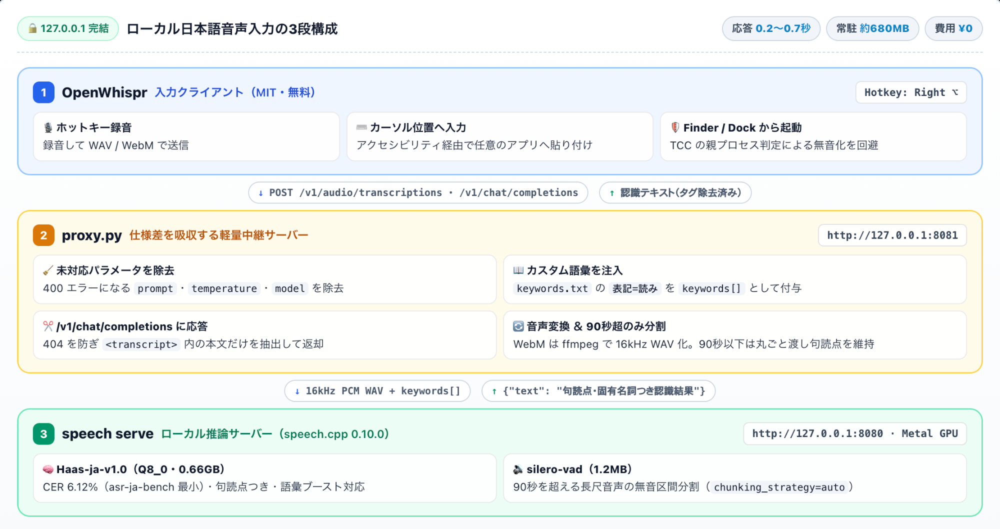

# haas-mac-dictation

Apple Silicon Mac 上で日本語音声認識モデル [Haas-ja-v1.0](https://huggingface.co/third-intelligence/Haas-ja-v1.0)（`speech.cpp` Metal 推論）とディクテーションクライアント [OpenWhispr](https://github.com/OpenWhispr/openwhispr)（または VoiceInk）をつなぐ軽量中継スクリプトと launchd 設定です。



## 役割 (`proxy.py`)

- `speech.cpp` が `400 Bad Request` で拒否する未対応フィールド（`prompt`、`temperature`、`model` など）を除去
- `keywords.txt` に記載したカスタム語彙（`表記=読み1,読み2`）を `keywords[]` として自動付与
- OpenWhispr が送信する `/v1/chat/completions`（テキスト補正）リクエストに対し、`<transcript>` 内の本文のみを抽出して `200 OK` で返却
- WebM/Opus 等の非 WAV 音声を `ffmpeg` で 16kHz モノラル PCM WAV に自動変換
- 90秒を超える長尺音声のみ `chunking_strategy=auto`（`silero-vad`）を付与し、通常の長さの発話では句読点の脱落を防止

## セットアップ

```sh
brew install ffmpeg
brew install --cask openwhispr

git clone https://github.com/akitana-airtanker/haas-mac-dictation.git
cd haas-mac-dictation
./setup.sh
```

### OpenWhispr 側の設定

1. Finder または Dock から **OpenWhispr** を起動します（ターミナルの子プロセスとして起動すると macOS TCC によりマイク入力が遮断されます）。
2. **音声認識 → セルフホスト** を選択し、以下を設定します。
   - サーバー URL：`http://127.0.0.1:8081/v1`
   - モデル：`Haas-ja-v1.0`
3. **言語モデル → ディクテーションのクリーンアップ** で「テキスト補正を有効にする」をオフにします。

## カスタム語彙の追加

`~/.local/share/haas-dictation/keywords.txt` に `表記=読み1,読み2` を1行ずつ追記して保存すると、再起動なしで次の発話から反映されます。

## 停止・アンインストール

```sh
./uninstall.sh
```

## ライセンス

MIT
